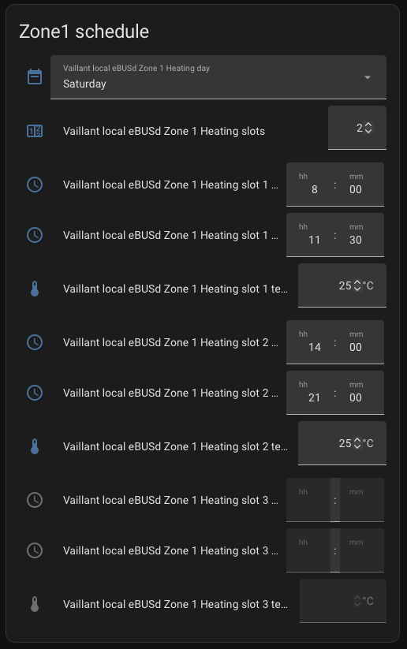
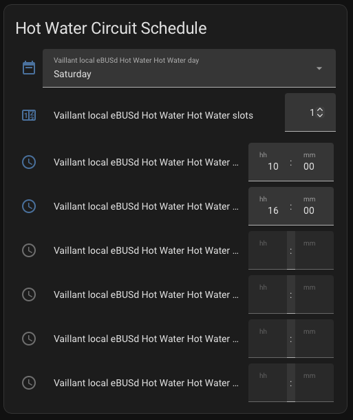
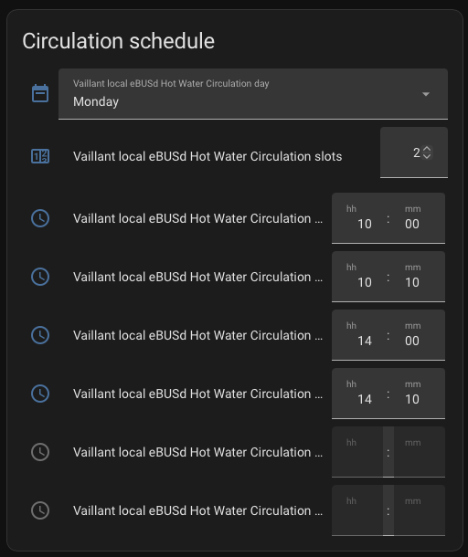

# Dashboard cards

Each time program comes with standard Home Assistant entities, so a plain
`entities` card is enough to edit a schedule: pick a weekday, then change the
slot count and the slot times.

!!! note
    Entity IDs depend on your device names. Replace `ebusd_vaillant` with
    your device (for example `heating_vaillant_local_ebusd_controller`). Find the
    exact IDs under **Settings** >> **Devices**.

## How editing works

- Select the weekday first. The slot entities then show and edit that day.
- Slot entities beyond the slot count are unavailable. Raise **slots** to use them.
- Times snap to 10-minute steps. `24:00` is shown as `23:59`.
- Changes are collected and sent to the controller as a full day 10 seconds after
  the last edit. While a change is waiting, the entities have `pending_write: true`.

## Zone 1 (heating)

Slots have a start, end and target temperature. Entities live on the Zone device.

```yaml
type: entities
title: Zone 1 schedule
show_header_toggle: false
entities:
  - entity: sensor.ebusd_vaillant_zone_1_heating_time_program
    name: Status
  - select.ebusd_vaillant_zone_1_heating_day
  - number.ebusd_vaillant_zone_1_heating_slots
  - time.ebusd_vaillant_zone_1_heating_slot_1_start
  - time.ebusd_vaillant_zone_1_heating_slot_1_end
  - number.ebusd_vaillant_zone_1_heating_slot_1_temperature
  - time.ebusd_vaillant_zone_1_heating_slot_2_start
  - time.ebusd_vaillant_zone_1_heating_slot_2_end
  - number.ebusd_vaillant_zone_1_heating_slot_2_temperature
  - time.ebusd_vaillant_zone_1_heating_slot_3_start
  - time.ebusd_vaillant_zone_1_heating_slot_3_end
  - number.ebusd_vaillant_zone_1_heating_slot_3_temperature
```



## Hot water (HWC)

Slots have a start and end only. The hot water temperature is not set per slot.
Entities live on the Hot Water device.

```yaml
type: entities
title: Hot water schedule
show_header_toggle: false
entities:
  - entity: sensor.ebusd_vaillant_hot_water_hot_water_time_program
    name: Status
  - select.ebusd_vaillant_hot_water_hot_water_day
  - number.ebusd_vaillant_hot_water_hot_water_slots
  - time.ebusd_vaillant_hot_water_hot_water_slot_1_start
  - time.ebusd_vaillant_hot_water_hot_water_slot_1_end
  - time.ebusd_vaillant_hot_water_hot_water_slot_2_start
  - time.ebusd_vaillant_hot_water_hot_water_slot_2_end
  - time.ebusd_vaillant_hot_water_hot_water_slot_3_start
  - time.ebusd_vaillant_hot_water_hot_water_slot_3_end
```



## Circulation

Same layout as hot water. Entities live on the Hot Water device.

```yaml
type: entities
title: Circulation schedule
show_header_toggle: false
entities:
  - entity: sensor.ebusd_vaillant_hot_water_circulation_time_program
    name: Status
  - select.ebusd_vaillant_hot_water_circulation_day
  - number.ebusd_vaillant_hot_water_circulation_slots
  - time.ebusd_vaillant_hot_water_circulation_slot_1_start
  - time.ebusd_vaillant_hot_water_circulation_slot_1_end
  - time.ebusd_vaillant_hot_water_circulation_slot_2_start
  - time.ebusd_vaillant_hot_water_circulation_slot_2_end
  - time.ebusd_vaillant_hot_water_circulation_slot_3_start
  - time.ebusd_vaillant_hot_water_circulation_slot_3_end
```



## Show only the slots in use

With the [conditional card](https://www.home-assistant.io/dashboards/conditional/),
hide slot rows that are not used on the selected day. Example for slot 3 of
circulation:

```yaml
type: conditional
conditions:
  - condition: numeric_state
    entity: number.vaillant_hot_water_circulation_slots
    above: 2
card:
  type: entities
  entities:
    - time.vaillant_hot_water_circulation_slot_3_start
    - time.vaillant_hot_water_circulation_slot_3_end
```
